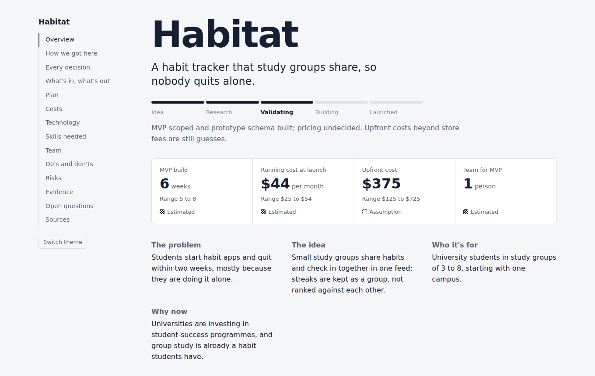
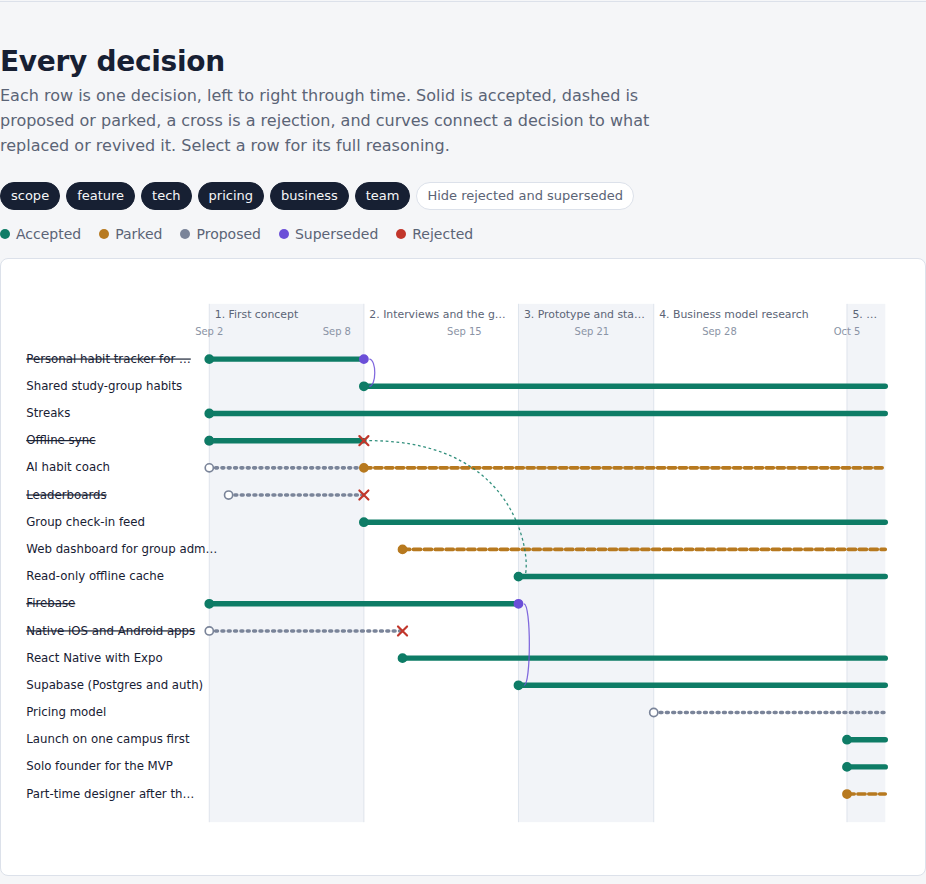
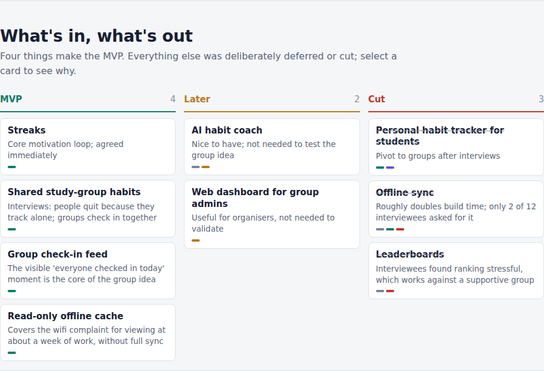
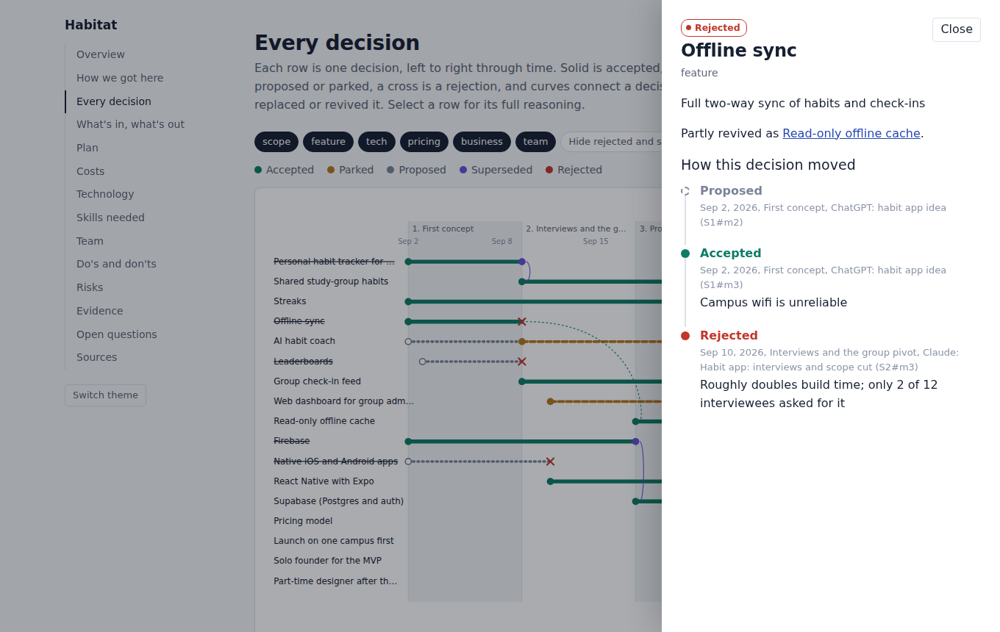
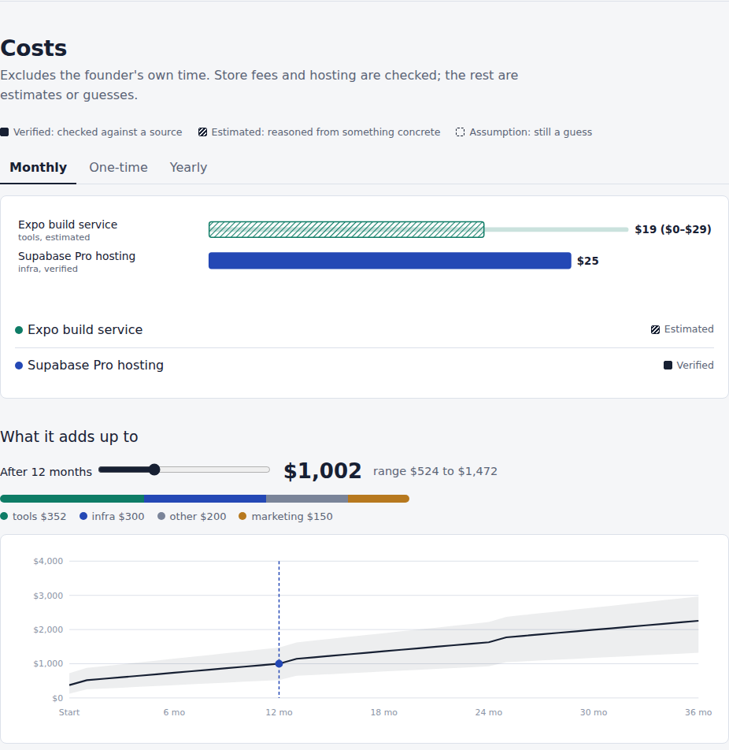
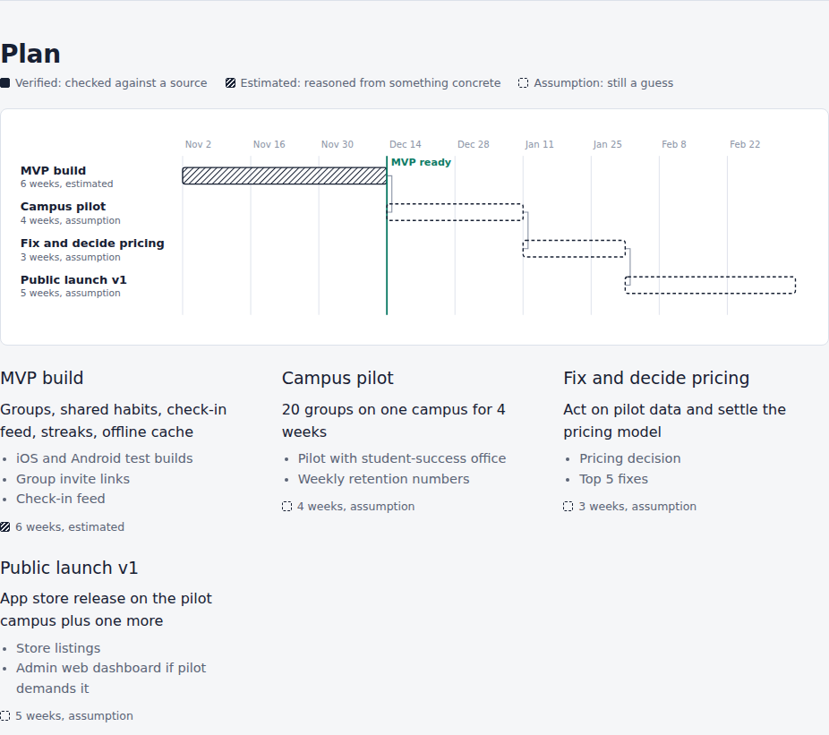
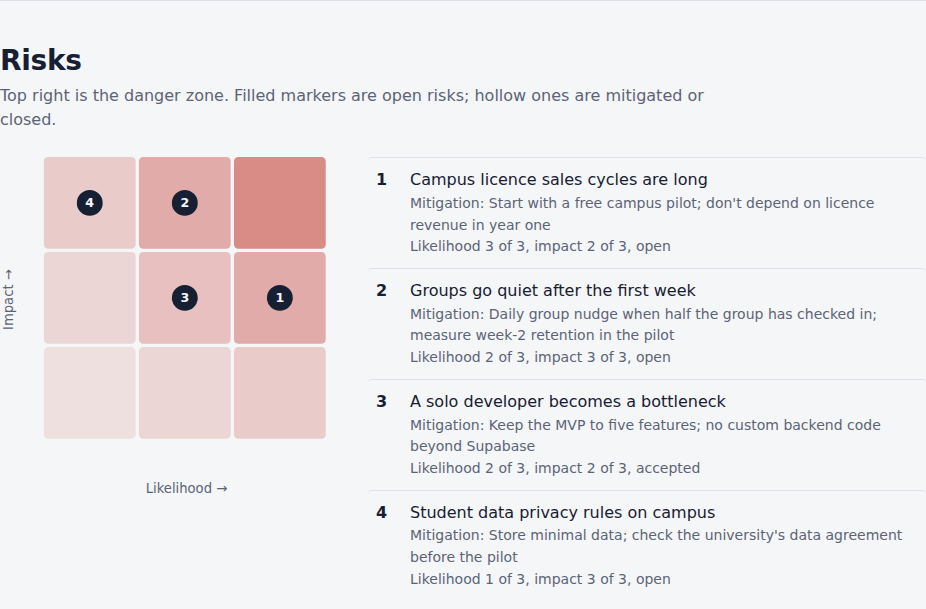
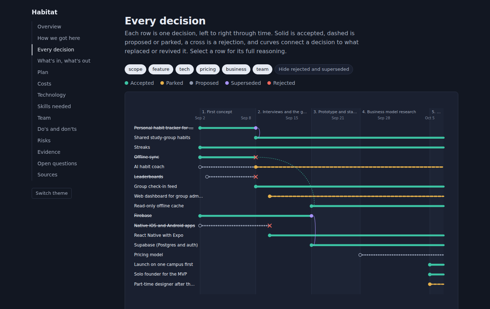
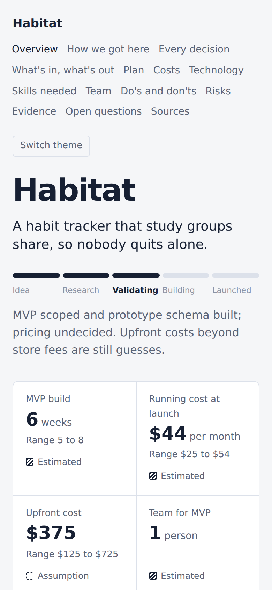

# Paper Trail

**Turn a long, messy idea exploration into a clean, honest, interactive document, including what you rejected and why.**

An [Agent Skill](https://agentskills.io) for Claude, Codex, GitHub Copilot, Gemini CLI, Cursor and other AI assistants. It keeps a running decision ledger while you research and brainstorm, merges in exported chats from other tools, and compiles everything into a single shareable HTML dossier.

[](https://github.com/ansh-saran-sharma/paper-trail/actions/workflows/ci.yml)
[](LICENSE)
[](https://agentskills.io)




---

## Contents

- [Why this exists](#why-this-exists)
- [What it does](#what-it-does)
- [How it's different](#how-its-different)
- [What you get](#what-you-get)
- [How it works](#how-it-works)
- [Compatibility](#compatibility)
- [Installation](#installation)
- [Quick start](#quick-start)
- [Ways to invoke it](#ways-to-invoke-it)
- [Exporting your chats from other tools](#exporting-your-chats-from-other-tools)
- [Options and configuration](#options-and-configuration)
- [What's in the repository](#whats-in-the-repository)
- [Troubleshooting](#troubleshooting)
- [FAQ](#faq)
- [Privacy and security](#privacy-and-security)
- [Roadmap](#roadmap)
- [Contributing](#contributing)
- [License](#license)

---

## Why this exists

Real ideas aren't decided in one chat. You research in one tool, brainstorm in another, prototype in a third. Features get added, dropped and half-revived. Costs get guessed, then checked. Six weeks later, nobody remembers why offline sync was cut, and the summary your assistant writes from the tail end of a long chat confidently presents a dead feature as planned and a guess as a fact.

Paper Trail fixes three things:

1. **Lost reasoning.** Decisions are logged *as they happen*, with their reasons, in a ledger that survives long conversations being compacted.
2. **Scattered research.** Exports from ChatGPT, Claude, Claude Code, Codex, Gemini and plain notes are merged into the same ledger, with every fact traceable to the message it came from.
3. **False confidence.** Every number is tagged verified, estimated or assumption, the build refuses unsupported "verified" claims, and sections that were never discussed are left out instead of filled with plausible filler.

## What it does

| Mode | When | What happens |
|---|---|---|
| **Capture** | While you discuss the idea | Decisions, numbers, questions, risks, evidence and milestones are appended to an append-only ledger, each with its reason |
| **Ingest** | You have chats in other tools | Exports are normalized into anchored transcripts, events are extracted and merged into the ledger |
| **Compile** | You're ready to share | The ledger becomes a validated, interactive dossier tailored to an audience: investors, your team, engineers, or yourself |

Key features:

- **Decision states:** proposed, accepted, rejected, parked, superseded, with partial revivals linked to what they revive. Invalid transitions are caught.
- **Confidence on every number:** verified (with source), estimated (with reasoning), assumption. Enforced at build time.
- **Evidence-gated sections:** no cost discussion means no cost section, and an open question saying so if the audience expects one.
- **Asks instead of guessing:** when something required is missing, the build stops and lists what's needed, split into questions only you can answer and fixes the agent makes itself.
- **Audience-aware:** the same facts reordered and folded for investors, team, engineers or a personal record.
- **Multi-tool ingestion:** ChatGPT (zip or JSON), Claude.ai, Claude Code, Codex, Gemini CLI, markdown or text from anything else.
- **Single-file output:** one HTML file, works offline, dark mode, mobile, print, keyboard accessible.
- **No dependencies:** Python 3.9+ standard library only, and every step also has a no-code fallback.

## How it's different

Tools that turn AI conversations into documents already exist. They mostly fall into three groups: **conversation summarizers** that write a recap at the end of a chat, **spec and requirements generators** that turn a discussion into a plan for building, and **meeting decision trackers** that pull decisions out of transcripts. Each is useful. Paper Trail is built around a different question: not "what did we end up with?" but **"how did we get here, and how sure are we?"**

| | Typical approach | Paper Trail |
|---|---|---|
| **When it captures** | Once, at the end, from whatever is still in the context window | Continuously, as decisions happen, so reasoning survives long chats being compacted. If started late, it says what it couldn't see |
| **What it keeps** | The final state | The whole path: every decision's states over time, with a reason at each step |
| **Changing your mind** | Overwrites, or leaves both versions to contradict each other | A fixed set of states (proposed, accepted, rejected, parked, superseded) plus partial revivals linked to what they revive. Contradictions are caught, not printed |
| **Numbers** | Stated with uniform confidence | Every number tagged verified, estimated or assumption; "verified" needs a source and "estimated" needs the reasoning, or the build refuses |
| **Gaps** | Filled with plausible text so every heading has content | Sections appear only when the conversation covered them; gaps become open questions |
| **When something's missing** | Guesses, or fails silently | Stops and tells you exactly what's missing and why it matters, as plain questions with honest options ("give the source, explain how you worked it out, or call it a guess"). Never upgrades a guess to get past a check |
| **Multiple tools** | One conversation in one tool | Merges ChatGPT, Claude, Claude Code, Codex, Gemini and plain notes into one ledger, with every fact traceable to the exact message it came from |
| **Accuracy of the write-up** | The model retypes facts while summarizing | Scripts copy facts mechanically; the model writes only the prose. Tests check the copy is exact |
| **Audience** | One document for everyone | The same facts reordered and folded for investors, team, engineers or a personal record |
| **Output** | Static text or markdown | A single interactive HTML file: decision river, feature board, plan, cost slider, risk matrix, with click-through history behind every item. Works offline, on phones, in print |
| **Where it runs** | Usually tied to one app | Any agent that reads the open `SKILL.md` format, plus a no-code fallback for chat apps. No dependencies |

What this adds up to:

- **It remembers why.** "Why did we drop offline sync?" has an answer months later, with a date and the chat it happened in.
- **It's honest about uncertainty.** A reader can tell at a glance, from the solid, hatched or hollow fill, which numbers were checked and which are hopes.
- **It shows the road not taken.** Rejected and replaced options stay visible with their reasons, which is often what a new teammate or an investor most wants to know.
- **It asks instead of inventing.** When a source or reason is missing, you get a short list of questions, not a confident fabrication.

## What you get

A single HTML file with up to 15 sections; each appears only if your ledger supports it. Try the live examples: [`examples/habitat/dossier.html`](examples/habitat/dossier.html) (startup idea, team audience), [`dossier-investor.html`](examples/habitat/dossier-investor.html) (same idea, investor audience) and [`examples/tidyfiles/dossier.html`](examples/tidyfiles/dossier.html) (side project, mostly empty by design).

| | |
|---|---|
|  **Decision river:** every decision through time; crosses are rejections, curves link replacements and revivals |  **What's in, what's out:** MVP / Later / Cut, with the reason on every card |
|  **Click anything** for its full history: every state change, when, in which chat, and why |  **Costs:** ranges, confidence fills, and a month slider for running totals |
|  **Plan:** milestones, dependencies, MVP line; hatched means estimated, dashed means guessed |  **Risks:** likelihood × impact with mitigations |

Also included: the idea's journey in chapters, evidence for and against, do's and don'ts, technology stack (with dropped alternatives struck through), skills and gaps, team per phase, open questions, and sources. Light and dark themes and phone layout are built in.

|  |  |
|---|---|

## How it works

In short: your assistant reads this skill's instructions when it recognizes you're developing an idea (or when you invoke it by name), logs durable events to `.dossier/ledger.jsonl` as you talk, and on request runs four small scripts: **normalize** exports → **check/replay** the ledger → **scaffold** a draft dossier with facts copied mechanically → **build** the validated HTML after the assistant writes the prose.

The full explanation, covering activation (implicit vs explicit), every step of every mode, and the exact form of each output, is in **[docs/HOW-IT-WORKS.md](docs/HOW-IT-WORKS.md)**.

## Compatibility

Skills use the open `SKILL.md` format, so the same folder works across tools. Install locations and explicit-invocation syntax as of October 2026 (these change often, so check your tool's docs if something doesn't match):

| Tool | Personal install path | Project install path | Explicit invocation | Implicit | Scripts run? |
|---|---|---|---|---|---|
| **Claude Code** | `~/.claude/skills/paper-trail/` | `.claude/skills/paper-trail/` | `/paper-trail` | Yes | Yes |
| **Claude.ai / Claude desktop** | Upload `paper-trail.skill` in Settings (Skills) | — | Name it in your message | Yes | Yes, with code execution enabled |
| **OpenAI Codex** (CLI, IDE, app) | `~/.agents/skills/paper-trail/` (older versions: `~/.codex/skills/`) | `.agents/skills/paper-trail/` | `$paper-trail` or `/skills` | Yes | Yes |
| **GitHub Copilot** (agent mode, CLI) | `~/.copilot/skills/paper-trail/` | `.github/skills/paper-trail/` | Name it in your message | Yes | Yes, in agent mode |
| **Gemini CLI** | `~/.gemini/skills/paper-trail/` or `~/.agents/skills/` | `.gemini/skills/paper-trail/` | `/skills` to manage; name it | Yes | Yes |
| **Cursor** | `~/.cursor/skills/paper-trail/` | `.cursor/skills/` or `.agents/skills/` | Name it in your message | Yes | Yes |
| **ChatGPT** (web) and other chat apps without skill support | Paste instructions (see [below](#chat-apps-without-skill-support)) | — | Always explicit | No | Only with a code tool |

`.agents/skills/` is a cross-tool convention that several agents read, which makes it a good single location for project installs.

## Installation

**Requirements:** an agent that supports Agent Skills. Python 3.9+ is *optional*; it lets the agent run the bundled scripts, and without it every step falls back to manual instructions. No third-party packages.

### Option A: one command with the skills CLI

The community [`skills` CLI](https://github.com/vercel-labs/skills) installs into most agents:

```bash
npx skills add ansh-saran-sharma/paper-trail                      # asks which agents to install into
npx skills add ansh-saran-sharma/paper-trail --agent claude-code  # or target one agent
```

### Option B: download a release

1. Go to [Releases](https://github.com/ansh-saran-sharma/paper-trail/releases) and download `paper-trail.skill` (for Claude apps) or `paper-trail-vX.Y.Z.zip` (for everything else).
2. For a zip, unzip it into your tool's skills folder from the table above, so you end up with `<skills folder>/paper-trail/SKILL.md`.
3. Restart your agent or start a new session.

### Option C: from source

```bash
git clone https://github.com/ansh-saran-sharma/paper-trail.git
cd paper-trail

# Claude Code (personal)
mkdir -p ~/.claude/skills && cp -r skills/paper-trail ~/.claude/skills/

# Codex (personal)
mkdir -p ~/.agents/skills && cp -r skills/paper-trail ~/.agents/skills/

# Gemini CLI (personal)
mkdir -p ~/.gemini/skills && cp -r skills/paper-trail ~/.gemini/skills/

# One project, shared with your team via git (read by several agents)
mkdir -p .agents/skills && cp -r /path/to/paper-trail/skills/paper-trail .agents/skills/
```

On Windows (PowerShell): `Copy-Item -Recurse skills\paper-trail $HOME\.claude\skills\`.

Gemini CLI can also install straight from git: `gemini skills install https://github.com/ansh-saran-sharma/paper-trail.git --path skills/paper-trail`.

### Claude.ai and Claude desktop

1. Download `paper-trail.skill` from [Releases](https://github.com/ansh-saran-sharma/paper-trail/releases) (or build it: `python tools/package_skill.py`).
2. Open Settings, find the Skills section (under Capabilities in current versions), and upload the file.
3. Make sure code execution / file creation is enabled so the scripts can run. Without it the skill still works using its manual fallbacks.

Note: the claude.ai sandbox resets between sessions. The skill offers the ledger file for download at each checkpoint; keep it and re-upload it next time.

### Chat apps without skill support

For ChatGPT (web), a custom GPT, or any assistant with "project instructions":

1. Paste the body of `skills/paper-trail/SKILL.md` into the instructions.
2. Attach the files in `references/` and `assets/dossier-template.html` as knowledge/files.
3. Enable the code tool (e.g. Code Interpreter) and upload `scripts/` if you want the scripts; otherwise the manual fallbacks are used.
4. Invoke it explicitly: "Use the paper-trail instructions to start a ledger for this idea."

### Verify the installation

- **Claude Code:** type `/` and look for `paper-trail` in the list.
- **Codex:** run `/skills` or type `$` and look for it.
- **Gemini CLI:** run `/skills`.
- **Anywhere:** ask "Which skills do you have available?", then "Use paper-trail to start tracking an idea about a recipe app" and check that it mentions creating `.dossier/ledger.jsonl` (or a ledger checkpoint in chat).

## Quick start

A five-minute tour, in any agent:

```text
You:   /paper-trail start. I want to build a habit tracker for university students.
Agent: Started a ledger at .dossier/ledger.jsonl. ... (normal brainstorming reply)
       Logged: I-001 First concept, D-001 accepted, D-002 proposed.

You:   Let's add offline sync, campus wifi is terrible. Firebase for the backend.
Agent: ... Logged: D-003 accepted, D-004 accepted.

You:   Actually drop offline sync. It doubles the build time and only 2 of 12
       people I interviewed asked for it.
Agent: ... Logged: D-003 rejected (reason recorded), E-001 re-estimated to 6 weeks.

You:   Here are my old ChatGPT and Gemini chats about this.  [uploads files]
Agent: Ingested 2 sources (Sept 2–25): 14 decisions, 5 estimates, 3 questions.
       One conflict: pricing differs between the chats. Which is current?

You:   Compile it for investors.
Agent: The dossier is ready except for one thing I can't fill in without you:
       the $25/month hosting cost is marked as checked, but where is it from?
       A link is enough, or tell me it's a guess.

You:   It's Supabase's pricing page.
Agent: [records the source in the ledger, builds dossier.html]
       Habitat is a habit tracker for study groups, at the validating stage...
       The biggest open question is whether students will pay.
```

Or try the bundled examples without any agent:

```bash
cd skills/paper-trail
python scripts/build_dossier.py assets/example-dossier.json --out example.html
open example.html        # macOS; use xdg-open on Linux or start on Windows
```

## Ways to invoke it

Each line below is a separate way to trigger the skill. Explicit forms are shown for Claude Code (`/paper-trail`) and Codex (`$paper-trail`); in other tools, write the skill's name in plain language. More walkthroughs are in **[USAGE.md](USAGE.md)**.

### Starting and capturing

| You say | What happens |
|---|---|
| `/paper-trail start` · `$paper-trail start` | Creates the ledger and starts logging |
| "Start a dossier for this idea" · "Track this idea" | Same, implicitly |
| "Keep a log of what we decide" · "Remember why we drop things" | Same, implicitly |
| *(just brainstorming for a while)* | May activate implicitly; if late, it backfills what it can still see |
| "Use paper-trail on this conversation so far" | Backfills from the visible conversation, then keeps logging |

### Checking progress

| You say | What happens |
|---|---|
| "Checkpoint" · "Save the ledger" | Chat-only: posts a ` ```ledger ` block of new events. With files: confirms and summarizes |
| "What have we decided so far?" | Status from the replayed ledger: accepted, rejected, open |
| "Why did we drop offline sync?" | That decision's full history: when, in which chat, and the reason at each step |
| "What's still undecided?" | Open questions and proposed-but-undecided decisions |

### Importing other chats

| You say | What happens |
|---|---|
| "Here are my exports" + upload files | Normalizes, extracts, merges, reports conflicts |
| "Add my ChatGPT export, only the chats about the habit app" | Filters with `--match` |
| "Add these, but only from September" | Filters with `--since` / `--until` |
| "List what's in this export first" | Preview with `--list`; you pick what to include |

### Compiling

| You say | What happens |
|---|---|
| "Compile" · "Make the doc" · "Make it shareable" | Asks the audience if unknown (default: team), then builds |
| "Make a version for investors" | Investor ordering; decisions and tech folded; skills left out |
| "Make an engineering brief" | Features, tech and decisions first |
| "Make a personal record of this" | Journey-heavy, keeps the reasoning texture |
| "Make it with no web fonts" | `--no-webfonts`: the file makes zero network requests |
| "Update the dossier" (after more discussion) | Re-scaffolds from the ledger and rebuilds |

### Running the scripts yourself

Everything the agent does can be done by hand. All scripts are in `skills/paper-trail/scripts/` and print `--help`.

```bash
S=skills/paper-trail/scripts

python $S/normalize_exports.py ~/Downloads/chatgpt.zip claude/conversations.json --match habit --list
python $S/normalize_exports.py ~/Downloads/chatgpt.zip claude/conversations.json --match habit --out .dossier/sources

python $S/ledger.py check  .dossier/ledger.jsonl
python $S/ledger.py replay .dossier/ledger.jsonl          # human-readable; add --json for machine-readable
python $S/ledger.py merge  saved-checkpoints.md --out .dossier/ledger.jsonl
python $S/ledger.py next-id .dossier/ledger.jsonl D

python $S/scaffold_dossier.py .dossier/ledger.jsonl --audience investor --sources .dossier/sources/sources.json --out dossier.json
# edit dossier.json: replace every "TODO:" string
python $S/build_dossier.py dossier.json --out dossier.html [--report findings.json] [--strict] [--no-webfonts]
# if it stops, it prints what's needed: questions for you, and fixes the agent (or you) can make
```

## Exporting your chats from other tools

Menu names change; if you can't find an export, copy-pasting the conversation into a `.md` file always works.

| Tool | How to export | What to give the skill |
|---|---|---|
| ChatGPT | Settings → Data controls → Export data; a download link arrives by email | The zip as-is, or `conversations.json` from it |
| Claude.ai | Settings → Privacy → Export data | `conversations.json` |
| Claude Code | Sessions are stored as files already | `~/.claude/projects/<project>/*.jsonl` |
| Codex CLI, Gemini CLI | Session/log files in their config folders | The `.jsonl` / `.json` files |
| Gemini (web), Copilot Chat, Cursor, Perplexity, others | Copy or export the chat | A `.md` or `.txt` file with speaker labels (`User:` / `Assistant:`, `## User`, `**You:**`) |
| Notes, docs, meeting notes | — | `.md` / `.txt`, treated as your own notes |

Full account exports contain all your chats. Always filter with `--match` (the agent does this when you say which idea).

## Options and configuration

| Setting | Where | Values | Default |
|---|---|---|---|
| Audience | Ask in chat, or `--audience` / `meta.audience` | `investor`, `team`, `engineer`, `personal` | `team` |
| Section order | `meta.section_order` in `dossier.json` | List of section keys | Per audience |
| Folded sections | `meta.collapsed` | List of section keys | Per audience |
| Currency | `meta.currency` / `costs.currency` | ISO code | `USD` |
| Plan start date | `plan.start_date` | ISO date | Week numbers |
| Strict build | `build_dossier.py --strict` | Optional findings become required | Off |
| Findings report | `build_dossier.py --report FILE` | JSON of what's needed and from whom | Off |
| No network fonts | `build_dossier.py --no-webfonts` | — | Web fonts on, with fallbacks |
| Ledger location | Working folder | `.dossier/ledger.jsonl` | — |

Section keys: `summary`, `journey`, `decisions`, `features`, `validation`, `pros_cons`, `dos_donts`, `plan`, `costs`, `tech`, `skills`, `team`, `risks`, `open_questions`, `sources`. Schema: [`references/dossier-schema.md`](skills/paper-trail/references/dossier-schema.md).

To make the skill run *only* when invoked by name: in Claude Code, add `disable-model-invocation: true` to the `SKILL.md` frontmatter; in Codex, set `allow_implicit_invocation: false` in an `agents/openai.yaml` file inside the skill folder (see [Codex's skills docs](https://developers.openai.com/codex/skills) for the file's layout). Other tools have their own settings; check their docs.

## What's in the repository

```
.
├── skills/paper-trail/            ← the skill itself (this folder is what gets installed)
│   ├── SKILL.md                    instructions the agent follows (modes, rules, commands)
│   ├── references/
│   │   ├── ledger-format.md        event types, ID scheme, decision state machine, confidence tags
│   │   ├── ingestion.md            export formats, extraction and cross-source merging
│   │   ├── dossier-sections.md     section inclusion rules and audience profiles
│   │   ├── dossier-schema.md       dossier.json schema
│   │   └── visuals.md              what each visual shows and needs
│   ├── scripts/                    Python 3.9+, standard library only
│   │   ├── normalize_exports.py    exports from many tools → anchored transcripts
│   │   ├── ledger.py               check / replay / merge / next-id
│   │   ├── scaffold_dossier.py     ledger → draft dossier.json (prose left as TODO)
│   │   └── build_dossier.py        validate + render dossier.html
│   └── assets/
│       ├── dossier-template.html   the renderer (inline SVG + vanilla JS, no libraries)
│       └── example-dossier.json    complete worked example
├── examples/                       ledgers, dossier.json files and built HTML (habitat, tidyfiles)
├── docs/
│   ├── HOW-IT-WORKS.md             activation, full process, outputs
│   └── images/                     screenshots used in this README
├── tests/                          unittest suite + fixture exports from five tools
├── evals/evals.json                prompts for testing the skill with a real agent
├── tools/
│   ├── package_skill.py            validate + build dist/*.skill and release zip
│   ├── rename_skill.py             rename the skill / fill repo placeholders in one go
│   └── build_examples.py           rebuild examples (and screenshots with --screenshots)
├── .github/                        CI workflow, issue and PR templates
├── README.md · USAGE.md · CONTRIBUTING.md · SECURITY.md · CODE_OF_CONDUCT.md · CHANGELOG.md · LICENSE
└── Makefile                        shortcuts: make test / package / examples
```

The release `.skill` and `.zip` contain only `skills/paper-trail/` (12 files, about 60 KB).

## Troubleshooting

<details>
<summary><b>The skill never activates</b></summary>

- Confirm the folder layout is `<skills folder>/paper-trail/SKILL.md` (not `paper-trail/paper-trail/SKILL.md` after unzipping) and that the file name is exactly `SKILL.md`.
- Restart the agent or start a new session; most tools load skills at session start.
- Check it's listed (`/` in Claude Code, `/skills` in Codex or Gemini CLI, Settings in Claude apps).
- Invoke it explicitly (`/paper-trail start`, `$paper-trail`, or "use the paper-trail skill"). Implicit activation is probabilistic, especially on the first turn of a new topic.
- Too many installed skills can push descriptions out of the agent's list; disable ones you don't use.
</details>

<details>
<summary><b>It activates when I don't want it to</b></summary>

Turn off implicit activation (see [Options](#options-and-configuration)) so it only runs when named, or just tell the agent "don't log this conversation".
</details>

<details>
<summary><b>It started late and missed early decisions</b></summary>

Expected when activation is implicit. It backfills from what's still visible and tells you which stretch it couldn't see. Export that earlier conversation (or copy it into a `.md` file) and say "add this". Next time, start with `/paper-trail start`.
</details>

<details>
<summary><b>"python: command not found" or scripts don't run</b></summary>

The skill works without Python using manual fallbacks, but the scripts make it more reliable. Install Python 3.9+, and if your system only has `python3`, the agent will use that. In claude.ai, enable code execution. In ChatGPT, enable the code tool and upload the scripts.
</details>

<details>
<summary><b>My export isn't recognized, or shows 0 messages</b></summary>

- Run `normalize_exports.py <file> --list` to see what was detected and any "skipped" reasons.
- ChatGPT: give it the zip or `conversations.json`, not `chat.html`.
- Markdown: speakers must be on their own label, like `User:` or `## Assistant`.
- Unknown formats are still included as notes. If a tool's format should be supported, open an issue with the "Export format" template and a small anonymized sample.
</details>

<details>
<summary><b>The build stopped and asked me questions</b></summary>

That's the honesty check working: the dossier would otherwise present something as more certain than it is. The agent fixes what it can from the ledger by itself, then asks you, in one message, only for what only you know. Typical questions:

- *Where does a "verified" number come from?* Give a link, quote or document, or say how you worked it out (it becomes estimated), or say it's a guess (it becomes an assumption).
- *How was an estimate worked out?* One sentence is enough.
- *What actually happened to a decision?* When its recorded history is impossible, e.g. something replaced and then accepted again.
- *What is the idea called, and what stage is it at?*

If you don't know, say so; the agent marks the item as a guess or turns it into an open question. It never invents a source to get past the check. Your answers go into the ledger, so the next compile won't ask again.

Running the scripts yourself? The same findings print grouped as **NEEDED FROM THE PERSON**, **AGENT CAN FIX**, and optional **WOULD MAKE IT STRONGER**; `--report findings.json` saves them as JSON.
</details>

<details>
<summary><b>"invalid transition superseded -> accepted"</b></summary>

`superseded` is final. To bring something back, create a new decision with `"revives": "<old id>"`. See [`ledger-format.md`](skills/paper-trail/references/ledger-format.md).
</details>

<details>
<summary><b>A section I expected is missing</b></summary>

Sections appear only when the ledger supports them (e.g. costs need at least one cost estimate). Discuss it, let it be logged, and compile again. The scaffold prints which sections it produced.
</details>

<details>
<summary><b>Fonts look different, or I need the file fully offline</b></summary>

The page uses Google Fonts when online and falls back to system fonts. Build with `--no-webfonts` to remove the font links entirely.
</details>

<details>
<summary><b>The ledger disappeared (claude.ai or chat apps)</b></summary>

The claude.ai sandbox resets between sessions, and chat-only ledgers live in your messages. Download the ledger at each checkpoint (the skill offers it), keep it with your project, and upload it at the start of the next session. Combine several saved checkpoints with `ledger.py merge`.
</details>

<details>
<summary><b>Undated sources don't show on the timeline</b></summary>

Some exports (e.g. copied markdown) have no timestamps. The agent should ask roughly when they happened; you can also set `started` / `ended` in `sources.json`.
</details>

<details>
<summary><b>The dossier looks wrong in an email preview</b></summary>

Email clients don't run JavaScript. Send it as an attachment, host it (any static host or GitHub Pages), or print to PDF from the browser.
</details>

## FAQ

**Does it send my data anywhere?** No. The scripts make no network calls. The HTML loads Google Fonts unless built with `--no-webfonts`. Your agent itself, of course, processes the conversation as it always does. See [SECURITY.md](SECURITY.md).

**Can I edit the ledger by hand?** Yes, it's plain JSON Lines. Prefer appending a new event over editing an old one so history stays intact, and run `ledger.py check` afterwards.

**Can I commit the ledger to git?** Yes, and it's a good idea for team projects: it's diff-friendly and gives the whole team the same decision history. Don't commit exports or `.dossier/sources/` if they contain private chats (the provided `.gitignore` excludes them).

**Does it work for non-software ideas?** Yes. A café, a research project, a nonprofit or a book plan all have decisions, costs, risks and open questions. Tech and skills sections simply won't appear if they weren't discussed.

**Can I change how it looks?** The renderer is `assets/dossier-template.html`. Colours and fonts are CSS variables at the top. See [CONTRIBUTING.md](CONTRIBUTING.md).

**Why not just ask my assistant for a summary?** A summary is written from whatever is still in context, gives every claim the same confidence, and can't show the path. This skill makes the path, the reasons and the uncertainty first-class.

## Privacy and security

Everything runs locally. Exports and ledgers can contain sensitive information; review a dossier before sharing it, because it includes decision history and source titles. Read **[SECURITY.md](SECURITY.md)** for the threat model and how to report vulnerabilities.

## Roadmap

- Export the dossier to PDF and Markdown
- A ledger viewer for diffs between two compiles ("what changed since the last version")
- More export formats (send samples via issues)
- Localization of the dossier's interface text
- Optional per-section comments for team review

Suggestions welcome via [issues](https://github.com/ansh-saran-sharma/paper-trail/issues).

## Contributing

Contributions are welcome: new export formats, visuals, translations, docs and bug reports. Start with **[CONTRIBUTING.md](CONTRIBUTING.md)**. Quick version:

```bash
git clone https://github.com/ansh-saran-sharma/paper-trail.git && cd paper-trail
python -m unittest discover -s tests -v     # no installs needed
python tools/package_skill.py               # builds dist/
```

Please follow the [Code of Conduct](CODE_OF_CONDUCT.md).

## License

[MIT](LICENSE) © Ansh Sharma

## Acknowledgements

Built on the open [Agent Skills](https://agentskills.io) format.
