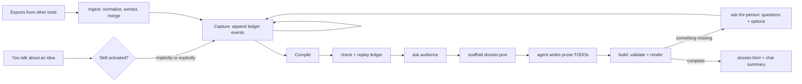

# How it works

This page explains three things: how the skill gets activated, everything that happens from activation to finished output, and what the output actually is.

- [1. Activation](#1-activation)
- [2. The complete process](#2-the-complete-process)
- [3. The output](#3-the-output)
- [Design decisions and why](#design-decisions-and-why)

---

## 1. Activation

A skill is a folder with a `SKILL.md` file. It isn't a program that runs in the background; it's a set of instructions (plus optional scripts) that an AI agent reads **when it decides the skill is relevant**, or when you tell it to use the skill.

### How agents load skills (progressive disclosure)

Agents that support the [Agent Skills](https://agentskills.io) format load skills in three layers, so installed skills cost almost nothing until they are needed:

| Layer | What's loaded | When |
|---|---|---|
| 1. Metadata | Only the `name` and `description` from the frontmatter (about 120 words for this skill) | At the start of every session, for every installed skill |
| 2. Instructions | The full body of `SKILL.md` | When the skill is activated |
| 3. Resources | Files in `references/`, `assets/`, `scripts/` | Only when the instructions say a step needs them. Scripts are *run*, not read |

### Two ways to activate it

**Implicitly (from context).** The agent compares what you're doing with every skill's description and activates the one that fits. This skill's description tells the agent to activate when you:

- explore an idea, product, startup, feature or project over many turns or chats
- say things like "track this", "keep a log of what we decide", "remember why we dropped X"
- ask to "summarize everything we discussed", "make a one-pager / pitch / brief", "compile my research"
- ask to combine chats from ChatGPT, Claude or Gemini, or upload exported conversation files

You never have to say "dossier" or "ledger".

**Explicitly (by name).** Every agent accepts the skill's name in plain language ("use the paper-trail skill"). Many also have a dedicated syntax:

| Tool | Explicit form |
|---|---|
| Claude Code | `/paper-trail` (the folder name becomes a slash command), optionally followed by what you want: `/paper-trail compile for investors` |
| OpenAI Codex (CLI, IDE, app) | `$paper-trail` mention, or pick it from `/skills` |
| Gemini CLI | `/skills` lists and manages installed skills; name the skill in your prompt to use it |
| Claude.ai / Claude desktop, GitHub Copilot, Cursor, others | Name it in your message: "Use paper-trail to start tracking this idea" |

Tool behavior changes often; check your tool's documentation if a form above doesn't work.

### Which one should you use?

Implicit activation is convenient but probabilistic: the agent might not activate the skill on the first turn of a brainstorm, because at that point nothing yet looks like "an idea explored over many turns". Since the whole value of the ledger is recording decisions *as they happen*, the reliable pattern is:

> **Start explicitly, finish however you like.** Open with `/paper-trail start` (or "start a dossier for this idea"), then talk normally. Later, "compile it" or "make a version for investors" is enough.

If the skill activates late anyway, it backfills from whatever part of the conversation is still visible and tells you which stretch it couldn't see (see [Starting late](#starting-late-backfill)).

### How long it stays active

Once activated, the skill's instructions stay in the agent's context for the rest of that session, so it keeps logging without being reminded. A *new* session starts fresh: with a filesystem, the ledger file is still there and the skill picks up where it left off the next time it activates. In chat-only apps, you re-upload or paste your saved ledger checkpoints.

---

## 2. The complete process



The three modes can happen in any order and any number of times. Most real use looks like: capture over several sessions, ingest a few old chats once, compile, keep capturing, compile again.

### Mode 1: Capture (during the conversation)

1. **Initialize.** The agent picks where the ledger lives:
   - **With a filesystem** (Claude Code, Codex, Gemini CLI, Cursor, Copilot agent mode, claude.ai with code execution): creates `.dossier/ledger.jsonl` in the working folder and tells you once.
   - **Chat only:** keeps the ledger as fenced ` ```ledger ` blocks posted at checkpoints, which you save.
2. **Listen for durable events.** Not every message is logged, only things that matter later:
   - a decision proposed, accepted, rejected, parked, superseded or revived (feature, scope, tech, pricing, audience, team…)
   - a number of any kind (cost, price, timeline, market size), always with a confidence tag
   - an unanswered question, or an answer to an earlier one
   - a risk, a piece of validation evidence, a lesson ("don't build your own auth")
   - a plan milestone
   - a change of direction, recorded as a new chapter ("iteration")
3. **Append, never edit.** Each event is one JSON line with a stable ID (`D-004`, `E-002`…). Changing your mind appends a new event for the same ID, so the history survives. The `reason` field records *why*.
4. **Stay out of the way.** With files, the agent appends silently and adds a single line to its reply ("Logged: D-007 accepted, E-003 estimated"). In chat-only mode it posts a checkpoint block only when asked, about every five events, at a big direction change, or when the conversation is getting long.

Decision states follow a fixed state machine (enforced by `ledger.py check`):

```
proposed ──► accepted ──► superseded (final; replaced by another decision)
    │           │ ▲
    ├──► parked ◄┘ │
    └──► rejected ─┘  (can be revived, with a reason)
```

A partial comeback ("full offline sync is out, a read-only cache is in") is a *new* decision linked with `revives`, so the original rejection reason stays true.

Every number gets one of three confidence tags: `verified` (needs a source), `estimated` (needs the reasoning), or `assumption`.

#### Starting late (backfill)

If the skill activates after a lot has already been said, the agent reads the transcript that is still in context, writes the events it can support, marks them `"backfilled": true`, and tells you which part of the conversation it could not see, so you can supply an export of that part if it mattered.

### Mode 2: Ingest (exports from other tools)

1. **Normalize.** `normalize_exports.py` auto-detects ChatGPT exports (including the downloaded zip), Claude.ai exports, Claude Code sessions, Codex/Gemini CLI logs, and markdown or text transcripts. It writes one transcript per conversation, oldest first, with every message tagged by an anchor like `[S2#m14]`, plus a `sources.json` manifest. You filter with `--match "keyword"` and dates; `--list` previews without writing anything.
2. **Extract, one source at a time.** The agent reads each transcript in date order and writes ledger events, each citing the exact anchor where the decision or number appears. Assistant suggestions you didn't act on are recorded as `proposed` at most, not as decisions.
3. **Merge across sources.** The same decision under different wording ("Supabase" vs "hosted Postgres with auth") is matched by meaning and kept under one ID. When chats disagree, the later one sets the current state and the reason records the reversal; when dates are unknown, the agent asks you instead of guessing.
4. **Check and report.** `ledger.py check` validates everything, then the agent tells you what was ingested, how many events came from each source, and any conflicts it needs you to settle.

### Mode 3: Compile (making the dossier)

1. **Check and replay.** `ledger.py check` validates the ledger; `ledger.py replay` computes the current state of everything. *The replayed state, not the agent's impression of the conversation, decides what is current.* (In chat-only mode, `ledger.py merge` first combines your saved checkpoint blocks.)
2. **Settle the audience.** If you haven't said, the agent asks once: investor, team/cofounder, engineers, or personal record. Default: team. Audience changes order and emphasis, never the facts.
3. **Scaffold.** `scaffold_dossier.py` writes a draft `dossier.json`, copying every decision with its full history, costs, plan, risks, evidence, skills, team, guidelines, questions and sources *mechanically*, so nothing gets retyped wrong. Sections with no supporting events are left out entirely. Every still-undecided decision automatically becomes an open question. Prose it can't write well is left as `TODO:`.
4. **Write the prose.** The agent fills each `TODO:` (chapter summaries, section intros, the evidence verdict, why each question matters), picks up to four headline numbers, trims each chapter to the changes that matter, and removes anything the audience doesn't need.
5. **Build.** `build_dossier.py` validates and renders. It **refuses to build** if a `TODO:` remains, a "verified" number has no source, an "estimated" number has no reasoning, a decision's current state contradicts its history, or a required field is missing.
6. **When it refuses: say what's needed.** Every finding is sorted by who can resolve it:
   - **Needed from the person:** facts only you know, phrased as plain questions with honest options. For example: *"Where does the $25/month hosting cost come from? Give a link, explain how you worked it out (it becomes estimated), or say it's a guess (it becomes an assumption)."*
   - **Agent can fix:** structure and prose it repairs from the ledger by itself, without bothering you.
   - **Would make it stronger (optional):** missing reasons, unverified costs, sections investors usually expect.

   The agent fixes its own items first, checks the ledger and conversation for answers, then asks you the rest **in one message**. Your answers are appended to the ledger and it rebuilds. If you can't answer, it takes the most conservative option (downgrade the confidence, or turn the item into an open question) and tells you. It never invents a source or upgrades a guess to get past the check. After a successful build it may mention up to three optional improvements as an offer.
7. **Self-check.** If a browser is available, the agent opens the result and checks: does anything rejected read as planned? Any number without a confidence badge? Would this audience get the first screen without scrolling?
8. **Deliver.** The agent hands you the file and writes a two-to-three sentence summary: what the idea is, where it stands, and the most important open question.

Without code execution, every step has a manual fallback described in `SKILL.md`: the agent replays by hand (last event per ID wins), writes the JSON itself, and pastes it into the template.

---

## 3. The output

There are four kinds of output, produced at different times:

| Output | Produced by | Format | Purpose |
|---|---|---|---|
| **Decision ledger** | Capture, Ingest | `.dossier/ledger.jsonl` (JSON Lines), or ` ```ledger ` blocks in chat | The durable record. Human-readable, diff-friendly, safe to commit to git |
| **Normalized sources** | Ingest | `.dossier/sources/S1.md…` + `sources.json` | Anchored transcripts the ledger cites |
| **Dossier data** | Compile | `dossier.json` | Everything the page shows, validated against honesty rules |
| **The dossier** | Compile | **`dossier.html`**, one self-contained file | The shareable document |

Plus, in the chat itself: one-line logging notices, checkpoint summaries on request, ingest reports, and a short summary when the dossier is delivered.

### The dossier file

A single HTML file, typically 70–100 KB, with all data, styles and scripts inline. It opens in any browser, works offline, can be emailed or attached, uploaded to any static host, or printed (folded sections expand on print). It follows the viewer's light or dark setting, adapts to phones, and is keyboard accessible. Built with `--no-webfonts`, it makes no network requests at all.

What it contains (each section appears only if the ledger supports it):

| Section | What you see | Interactive |
|---|---|---|
| Overview | Name, one-liner, stage track (idea → launched), status, up to four headline numbers with ranges and confidence, problem / idea / audience / why now, a bar showing how all decisions ended up | Confidence badges show the source or reasoning |
| How we got here | Numbered chapters of the idea's evolution, each with its state changes | Each change opens that decision's history |
| Every decision | The **decision river**: one lane per decision through time, chapter bands behind it, crosses for rejections, curves from superseded choices to their replacements and from rejected ideas to their revivals | Filter by area, hide rejected ones, click or press Enter on a lane |
| What's in, what's out | MVP / Later / Undecided / Cut board with the reason on every card | Cards open full history |
| Plan | Timeline with dependencies, an "MVP ready" line, bars filled by confidence | — |
| Costs | Range bars per item (monthly / one-time / yearly tabs), cumulative cost curve with a low–high band, category split | Month slider (1–36) updates totals live |
| Technology | Layered stack; dropped alternatives struck through beside what replaced them | Click to see why |
| Skills, Team | Required level and gaps; roles per phase, optional roles hollow | — |
| Do's and don'ts | Lessons with their reasons | — |
| Risks | Likelihood × impact matrix | Hover highlights the matching mitigation |
| Evidence | Weighted for/against balance and per-item bars | — |
| Open questions | What's unresolved and which decisions wait on it | Links to blocked decisions |
| Sources | When each conversation happened and in which tool | — |

**The visual grammar is consistent everywhere.** Confidence is shown by fill (solid = verified, hatched = estimated, hollow dashed = assumption), so it survives greyscale printing. Decision states have fixed colours and line styles.

---

## Design decisions and why

| Decision | Why |
|---|---|
| Log during the conversation, compile at the end | Long conversations get compacted or truncated; reasoning from early iterations is often gone by the time someone asks for a summary |
| Append-only ledger | The path matters as much as the destination. You can't explain "why not X" if X's rejection was overwritten |
| `rejected` vs `superseded` vs `revives` | "We chose not to", "we chose it, then found better" and "it came back smaller" are different stories, and readers need to tell them apart |
| Confidence on every number, enforced by the build | A clean document makes guesses look like facts. That's dangerous when it goes to investors |
| Sections only with evidence | An absent section is honest; a section padded with plausible filler isn't |
| Refusals become questions, sorted by who can answer | A refusal is only useful if it says what to do. Separating "only you know this" from "the agent can fix this" keeps the questions few and specific |
| Scripts copy facts, the model writes prose | Models are good at summarizing and bad at faithfully retyping 70 dated events |
| Standard library Python, no dependencies, single-file HTML | Works in any agent sandbox, offline, and the output can go anywhere |
